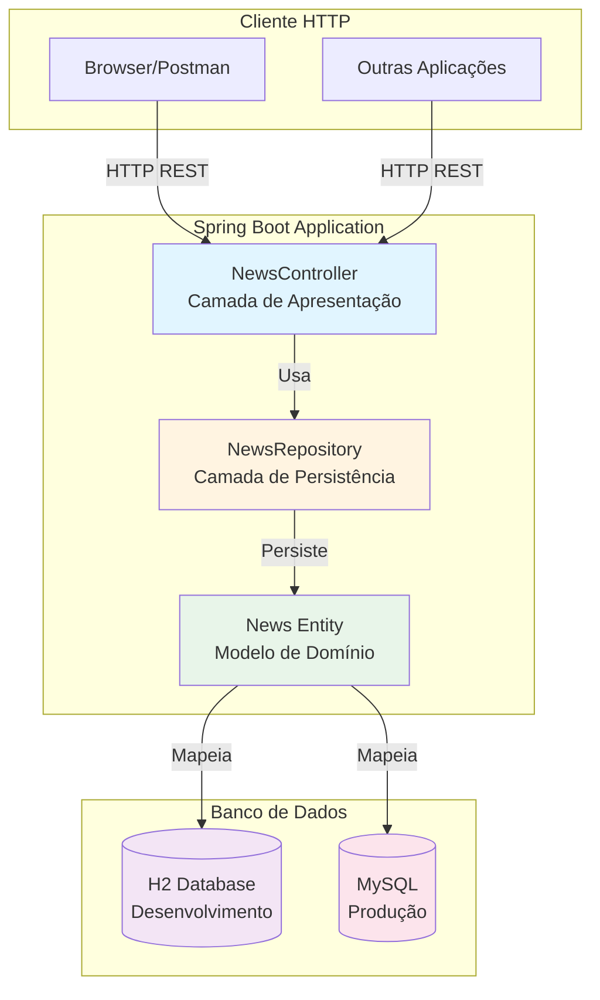
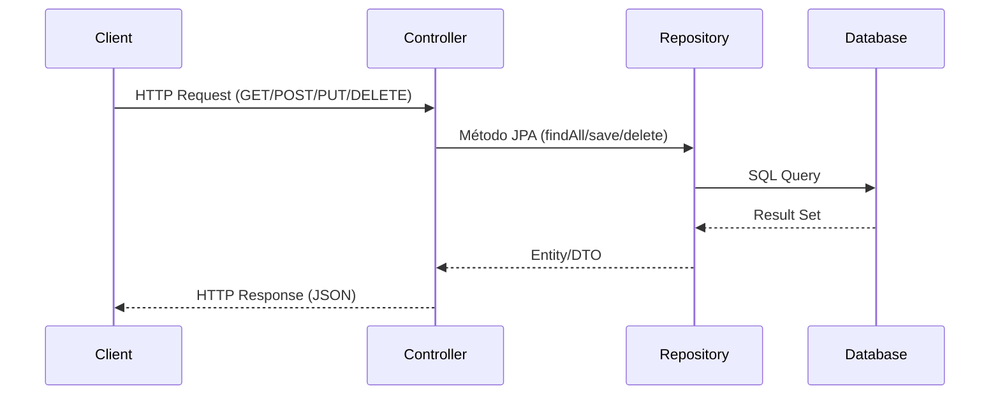

# News API

> **API RESTful** - Sistema de gerenciamento de notícias com operações CRUD completas, demonstrando boas práticas de desenvolvimento com Spring Boot.

[](https://www.oracle.com/java/)
[](https://spring.io/projects/spring-boot)
[](https://www.h2database.com/)
[](https://maven.apache.org/)
[](LICENSE)

## Sobre o Projeto

O **News API** é uma aplicação RESTful desenvolvida com Spring Boot para gerenciamento de notícias. O projeto implementa todas as operações CRUD (Create, Read, Update, Delete) e demonstra boas práticas de desenvolvimento backend, incluindo arquitetura em camadas, uso de JPA para persistência e configuração flexível de banco de dados.

### Objetivos

- Demonstrar implementação de **API RESTful** completa
- Aplicar **arquitetura em camadas** (Controller, Repository, Entity)
- Implementar operações **CRUD** com validações
- Configurar **banco de dados em memória** (H2) para desenvolvimento
- Servir como **portfólio técnico** demonstrando competências em Spring Boot

## Arquitetura

### Estrutura em Camadas

O projeto segue o padrão de arquitetura em camadas do Spring Boot:



### Fluxo de Requisição



## Stack Tecnológica

### Core
- **Java 21** - Linguagem de programação
- **Spring Boot 3.2.0** - Framework principal
- **Spring Web** - Para criar aplicações web RESTful usando Spring MVC
- **Spring Data JPA** - Framework para acesso a dados com mapeamento objeto-relacional (ORM)
- **Apache Tomcat** - Container Web embutido (incluído no Spring Boot)

### Banco de Dados
- **H2 Database** - Banco em memória para desenvolvimento (configurado por padrão)
- **MySQL** - Banco de dados para produção (configuração disponível)

### Ferramentas
- **Lombok** - Redução de código boilerplate (anotações @Data, @AllArgsConstructor, etc.)
- **Apache Maven** - Gerenciamento de dependências e build
- **Maven Wrapper** - Execução do projeto sem necessidade de Maven instalado

### Modos de Execução

O projeto foi projetado para rodar **sem necessidade de infraestrutura complexa**, oferecendo dois modos de execução:

- **Desenvolvimento**: H2 em memória para rodar rapidamente sem configuração
- **Produção**: MySQL para ambiente de produção (configuração comentada no `application.properties`)

## Estrutura do Projeto

```
Projeto-News-API-Java-Spring-Boot/
├── src/
│   ├── main/
│   │   ├── java/com/aronalvarenga/news/
│   │   │   ├── controller/
│   │   │   │   └── NewsController.java      # Endpoints REST
│   │   │   ├── entity/
│   │   │   │   └── News.java                # Entidade JPA
│   │   │   ├── repository/
│   │   │   │   └── NewsRepository.java      # Interface JPA Repository
│   │   │   └── NewsApplication.java         # Classe principal
│   │   └── resources/
│   │       └── application.properties        # Configurações da aplicação
│   └── test/
│       └── java/com/aronalvarenga/news/
│           └── NewsApplicationTests.java     # Testes
├── mvnw                                      # Maven Wrapper (Linux/Mac)
├── mvnw.cmd                                  # Maven Wrapper (Windows)
├── pom.xml                                   # Configuração Maven
└── README.md
```

## Modelo de Dados

### Entidade News

```java
@Entity
@Table(name = "news")
public class News {
    @Id
    @GeneratedValue(strategy = GenerationType.IDENTITY)
    private Long id;
    
    @Column(length = 100, nullable = false)
    private String title;
    
    @Column(length = 300, nullable = false)
    private String description;
    
    @Column(nullable = false)
    private Date dateTime;
}
```

## Como Executar

### Pré-requisitos

- **Java 21** instalado
  - Verificar: `java -version`
  - Download: [Oracle JDK 21](https://www.oracle.com/java/technologies/downloads/#java21) ou [OpenJDK 21](https://adoptium.net/)
- **Maven** (opcional - o projeto inclui Maven Wrapper)

### Executando Localmente

1. **Clone o repositório**
   ```bash
   git clone https://github.com/seu-usuario/Projeto-News-API-Java-Spring-Boot.git
   cd Projeto-News-API-Java-Spring-Boot
   ```

2. **Execute a aplicação**

   **Opção A: Usando Maven Wrapper (Recomendado)**
   
   Windows (PowerShell/CMD):
   ```bash
   .\mvnw.cmd spring-boot:run
   ```
   
   Linux/Mac:
   ```bash
   ./mvnw spring-boot:run
   ```
   
   **Opção B: Usando Maven (se instalado)**
   ```bash
   mvn spring-boot:run
   ```
   
   **Opção C: Via IDE**
   - Abra o projeto na sua IDE (IntelliJ IDEA, Eclipse, VS Code)
   - Localize `NewsApplication.java`
   - Execute o método `main()`

3. **Acesse a aplicação**
   - API Base: `http://localhost:8080`
   - Console H2: `http://localhost:8080/h2-console`
     - JDBC URL: `jdbc:h2:mem:news_db`
     - Usuário: `sa`
     - Senha: (deixe vazio)

### Configurando MySQL (Opcional)

Para usar MySQL em vez de H2, edite `src/main/resources/application.properties`:

1. Comente as configurações do H2
2. Descomente as configurações do MySQL
3. Ajuste as credenciais conforme necessário

## Endpoints da API

### Base URL
```
http://localhost:8080/news
```

### Operações CRUD

#### 1. Listar todas as notícias
```http
GET /news
```

**Resposta:**
```json
[
  {
    "id": 1,
    "title": "Título da Notícia",
    "description": "Descrição da notícia",
    "dateTime": "2024-01-15T10:30:00.000+00:00"
  }
]
```

#### 2. Criar nova notícia
```http
POST /news
Content-Type: application/json
```

**Body:**
```json
{
  "title": "Nova Notícia",
  "description": "Descrição da nova notícia"
}
```

**Resposta:** `201 Created`
```json
{
  "id": 1,
  "title": "Nova Notícia",
  "description": "Descrição da nova notícia",
  "dateTime": "2024-01-15T10:30:00.000+00:00"
}
```

#### 3. Atualizar notícia
```http
PUT /news
Content-Type: application/json
```

**Body:**
```json
{
  "id": 1,
  "title": "Título Atualizado",
  "description": "Descrição atualizada"
}
```

**Resposta:** `200 OK` ou `404 Not Found`

#### 4. Deletar notícia
```http
DELETE /news/{id}
```

**Exemplo:**
```http
DELETE /news/1
```

**Resposta:** `200 OK` ou `404 Not Found`

## Testando a API

### Usando cURL

**Listar notícias:**
```bash
curl http://localhost:8080/news
```

**Criar notícia:**
```bash
curl -X POST http://localhost:8080/news \
  -H "Content-Type: application/json" \
  -d '{"title":"Minha Notícia","description":"Descrição da notícia"}'
```

**Atualizar notícia:**
```bash
curl -X PUT http://localhost:8080/news \
  -H "Content-Type: application/json" \
  -d '{"id":1,"title":"Título Atualizado","description":"Nova descrição"}'
```

**Deletar notícia:**
```bash
curl -X DELETE http://localhost:8080/news/1
```

### Usando Postman

1. Importe a coleção ou crie requisições manualmente
2. Configure a base URL: `http://localhost:8080/news`
3. Teste cada endpoint conforme descrito acima

## Funcionalidades

- **CRUD Completo** - Create, Read, Update, Delete de notícias
- **Validação de Dados** - Campos obrigatórios e tamanhos máximos
- **Data/Hora Automática** - Campo `dateTime` preenchido automaticamente
- **Banco em Memória** - H2 configurado para desenvolvimento rápido
- **Console H2** - Interface web para visualizar dados
- **Arquitetura em Camadas** - Separação clara de responsabilidades

## Diferenciais Técnicos

### Boas Práticas Implementadas

- **Arquitetura em Camadas**: Separação clara entre Controller, Repository e Entity
- **Injeção de Dependência**: Uso de `@Autowired` para desacoplamento
- **JPA/Hibernate**: Mapeamento objeto-relacional automático
- **Lombok**: Redução de boilerplate com anotações
- **Maven Wrapper**: Projeto executável sem necessidade de Maven instalado
- **Configuração Flexível**: Fácil alternância entre H2 e MySQL

## Banco de Dados

### H2 (Desenvolvimento)

O H2 é um banco de dados em memória que:
- Não requer instalação ou configuração
- É criado automaticamente ao iniciar a aplicação
- Permite acesso via console web em `/h2-console`
- Os dados são perdidos ao reiniciar a aplicação

### MySQL (Produção)

Para usar MySQL em produção:
1. Configure o banco de dados MySQL
2. Ajuste as propriedades no `application.properties`
3. Descomente as configurações do MySQL

## Desenvolvimento

### Estrutura de Código

- **Controller**: Gerencia requisições HTTP e respostas
- **Repository**: Interface JPA para acesso a dados
- **Entity**: Modelo de domínio com anotações JPA
- **Application**: Classe principal com método `main()`

### Próximas Melhorias (Sugestões)

- [ ] Validação com Bean Validation (@NotNull, @Size, etc.)
- [ ] Tratamento de erros global (@ControllerAdvice)
- [ ] DTOs para separar entidade de resposta
- [ ] Paginação nas listagens
- [ ] Filtros e busca por título/descrição
- [ ] Testes unitários e de integração
- [ ] Documentação com Swagger/OpenAPI
- [ ] Autenticação e autorização (Spring Security)
- [ ] Auditoria (createdAt, updatedAt)

## Testes

### Executando Testes

```bash
# Usando Maven Wrapper
./mvnw test

# Ou usando Maven
mvn test
```

## Novo Direcionamento

* Transformar em **News CMS-lite**:
  * Notícia com **status** (draft/published/archived), autor/editor, tags/categorias.
  * **Busca e filtros**, paginação, ordenação.
  * **Auditoria** + versionamento simples (histórico de edições).
  * **Documentação e testes**, profile dev/prod e migrations.

## Contribuindo

Contribuições são bem-vindas! Sinta-se à vontade para:

1. Fazer fork do projeto
2. Criar uma branch para sua feature (`git checkout -b feature/AmazingFeature`)
3. Commit suas mudanças (`git commit -m 'Add some AmazingFeature'`)
4. Push para a branch (`git push origin feature/AmazingFeature`)
5. Abrir um Pull Request

## Licença

Este projeto está sob a licença MIT. Veja o arquivo [LICENSE](LICENSE) para mais detalhes.

## Autor

**Aron Alvarenga**

- GitHub: [@aron-alvarenga](https://github.com/aron-alvarenga)
- LinkedIn: [Aron Alvarenga](https://www.linkedin.com/in/aron-alvarenga)

## Agradecimentos

- Spring Framework e comunidade Spring
- Todos os mantenedores das bibliotecas open-source utilizadas
- Comunidade Java e Spring Boot

---

**Nota**: Este projeto demonstra conceitos fundamentais de desenvolvimento backend com Spring Boot, servindo como base para projetos mais complexos e como portfólio técnico.

